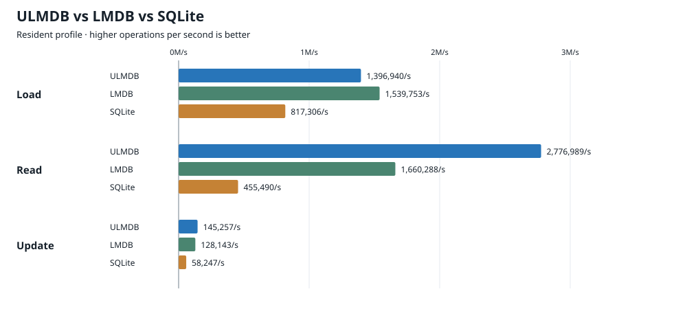
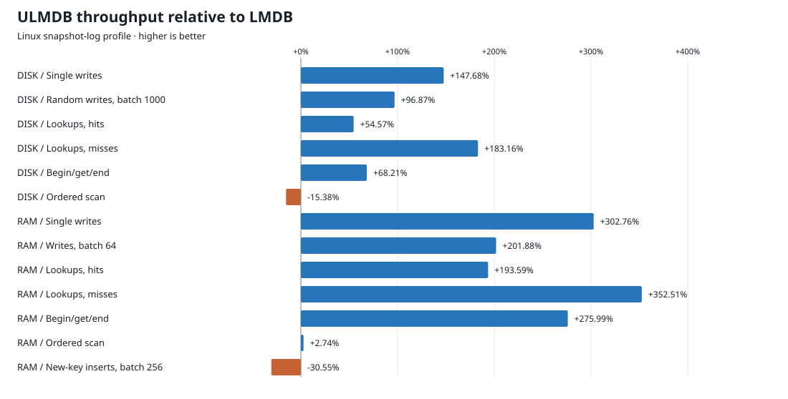
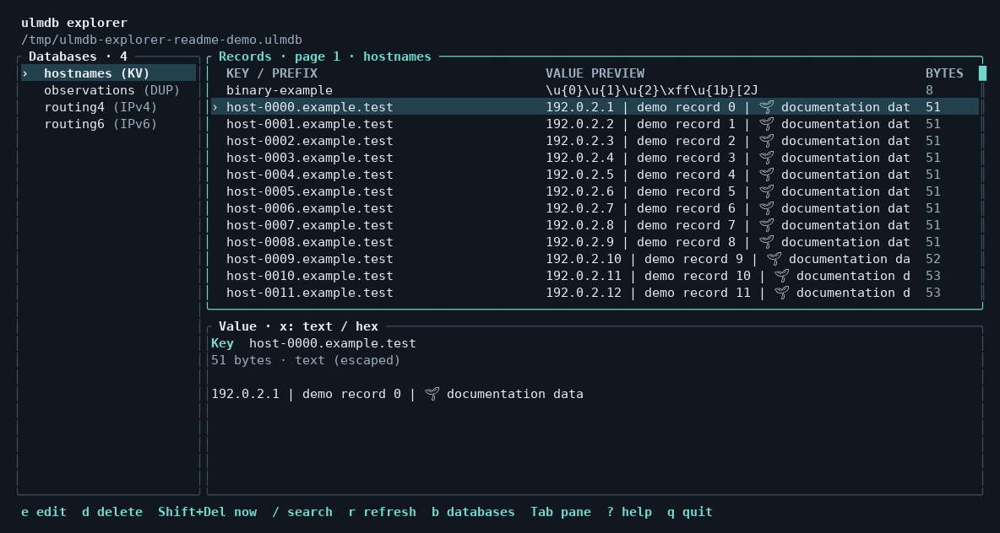

# Ultra Low-Latency Memory-Mapped Database (ULMDB) 
**ULMDB is one of the the fastest Rust key-value databases.**

**12.2 million successful lookups/second in RAM — 2.94× LMDB and 6.1× faster than SQLite in read performance**

**Ultra Low-latency Memory-mapped Database** is based on the design of
the older [LMDB](https://www.symas.com/lmdb.php), an
embedded C key-value database with memory-mapped storage, transactions and
concurrent snapshot readers. Both run inside your application, without a server.

ULMDB implements that model in Rust with its own storage format, native
IPv4/IPv6 CIDR indexes and optional backends for different workloads. It supports
ordered scans, named databases and duplicate values on disk or a RAM drive.
Its LMDB adapter provides compatible API calls and imports existing LMDB data. It is capable of serving as drop-in replacement to where LMDB is used today.

## Performance

### ULMDB vs LMDB vs SQLite

**1.67× LMDB and 6.10× SQLite read throughput** with the Resident backend.
One million keys, 1,000 writes per durable transaction. Operations per second,
geometric means of three runs. SQLite uses WAL with `synchronous=FULL`.

| Operation | ULMDB/s | LMDB/s | SQLite/s | ULMDB / SQLite |
| --- | ---: | ---: | ---: | ---: |
| Load | 1,396,940 | 1,539,753 | 817,306 | 1.71× |
| Read | 2,776,989 | 1,660,288 | 455,490 | 6.10× |
| Update | 145,257 | 128,143 | 58,247 | 2.49× |



Results depend on workload and backend. LMDB still leads on disk scans, new-key
RAM inserts, startup/reopen times and some memory/storage costs.
[Full three-way comparison](benchmark/ULMDB_VS_LMDB_VS_SQLITE.md).

### ULMDB vs LMDB

Linux snapshot-log backend. Operations per second; higher is better.
Synchronous commits; RAM uses tmpfs. Medians of five runs.

| Workload | ULMDB/s | LMDB/s | Difference |
| --- | ---: | ---: | ---: |
| Disk · single writes | 38,809 | 15,669 | +147.68% |
| Disk · random writes, batch 1,000 | 358,476 | 182,084 | +96.87% |
| Disk · lookup hits | 4,341,367 | 2,808,680 | +54.57% |
| Disk · lookup misses | 8,547,995 | 3,018,764 | +183.16% |
| Disk · begin/get/end | 3,659,570 | 2,175,540 | +68.21% |
| Disk · ordered scan | 56,581,408 | 66,864,854 | −15.38% |
| RAM · single writes | 556,530 | 138,180 | +302.76% |
| RAM · writes, batch 64 | 2,335,260 | 773,569 | +201.88% |
| RAM · lookup hits | 12,180,311 | 4,148,720 | +193.59% |
| RAM · lookup misses | 18,741,171 | 4,141,560 | +352.51% |
| RAM · begin/get/end | 9,049,584 | 2,406,847 | +275.99% |
| RAM · ordered scan | 63,499,415 | 61,808,412 | +2.74% |
| RAM · new-key inserts, batch 256 | 589,050 | 848,173 | −30.55% |



Durable single-write latency: **25.77 µs average / 40.21 µs p99**, versus
63.82 µs / 320.39 µs for LMDB.

These results use the optional `snapshot-log` feature and
`ulmdb::snapshot_log::Environment`, with versioned values and exact lookup.
The default `Environment` uses Legacy and has different performance.
[Full results and configuration](benchmark/snapshot-log-20261108/REPORT.md).

## Get started

Requires Rust 1.94.0, pinned in the repository.

```sh
cargo build --release --locked -p ulmdb
cargo run --release --locked -p ulmdb -- demo /tmp/new-ulmdb
```

The demo path must be new. To use the Rust API:

```rust
use ulmdb::{DatabaseKind, Environment, Result};

fn main() -> Result<()> {
    let env = Environment::create("my-database")?;
    let mut write = env.begin_write()?;
    write.create_database(b"users", DatabaseKind::Kv)?;
    write.put(b"users", b"alice", b"Alice")?;
    write.commit()?;

    let read = env.begin_read();
    assert_eq!(read.kv(b"users")?.get(b"alice")?, Some(b"Alice".as_slice()));
    Ok(())
}
```

[Rust examples](clients/rust/examples) · [IPv4/IPv6 example](clients/rust/examples/routes.rs) ·
[C, C++, Rust, Python and Node.js clients](clients/README.md)

## Explore your data

**ulmdb explorer** (`uexplorer`) is a terminal app for browsing and editing your
databases. Choose a named database, scroll or search its records, and inspect
values as text or hex. Edit, delete and refresh without leaving the app.



```sh
cargo run --release --locked -p uexplorer -- /path/to/database
```

Omit the path to open the file picker. Use `--read-only` to disable changes.
Keyboard and mouse navigation are supported; press `?` for help.
[Explorer guide and demo data](utility/explorer/README.md).

## LMDB compatibility

The [LMDB adapter](clients/lmdb-ulmdb/README.md) exports all 56 public LMDB 0.9
functions and passes the [functional conformance profile](clients/lmdb-ulmdb/conformance/REPORT.md)
against LMDB 0.9.31 and 1.0.2. Existing LMDB data imports into native ULMDB
storage while preserving the original files.
[Compatibility limits and remaining work](clients/lmdb-ulmdb/PARITY_GAPS.md).

ULMDB is experimental; production durability and full LMDB parity are not yet
established.

More: [Engine source](crates/ulmdb) · [IPDon regional database](crates/ulmdb-ipdon/README.md) ·
[Utilities](utility/README.md)
