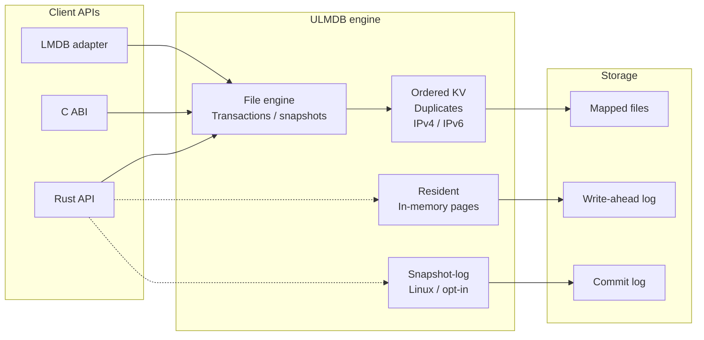

# Ultra Low-Latency Memory-Mapped Database (ULMDB) 
**A very fast Rust key-value database**

**11.7 million successful lookups/second in RAM. 2.83x LMDB with the snapshot-log backend**

**Ultra Low-latency Memory-mapped Database** is based on the design of [LMDB](https://www.symas.com/lmdb.php), an
embedded C key-value database with memory-mapped storage, transactions and
concurrent snapshot readers. Both run inside your application (embedded), without a server.

ULMDB implements that embedded model in Rust with its own storage format. In addition, it has native
IPv4/IPv6 CIDR indexes and optional backends for different workloads. It supports
ordered scans, named databases and duplicate values on disk or a RAM drive.
Its LMDB adapter provides compatible API calls and imports existing LMDB data. It is capable of serving as drop-in replacement to where LMDB is used today.

## Performance

### ULMDB vs LMDB vs SQLite

Resident backend against **LMDB 1.0.2** and **SQLite 3.45.1**.
One million keys, 1,000 writes per durable transaction. Rates are operations per
second, geometric means of three runs. SQLite uses WAL with `synchronous=FULL`.

| Operation | ULMDB/s | LMDB/s | SQLite/s | ULMDB / SQLite |
| --- | ---: | ---: | ---: | ---: |
| Load | 1,396,940 | 1,539,753 | 817,306 | 1.71x |
| Read | 2,776,989 | 1,660,288 | 455,490 | 6.10x |
| Update | 145,257 | 128,143 | 58,247 | 2.49x |

#### Throughput compared


### ULMDB vs LMDB

Snapshot-log backend against **LMDB 0.9.36 on disk** and **LMDB 1.0.2 in RAM**.
Synchronous commits on Linux; RAM uses tmpfs. Lookups and scans are warm.
Rates are operations per second, medians of five runs. Batch rates count rows.
Requires the opt-in `snapshot-log` feature; the default backend is Legacy.

| Workload | ULMDB/s | LMDB/s | Difference |
| --- | ---: | ---: | ---: |
| Disk / single writes | 39,776 | 15,773 | +152.18% |
| Disk / random writes, batch 1,000 | 521,448 | 177,492 | +193.79% |
| Disk / lookup hits | 6,108,015 | 2,782,737 | +119.50% |
| Disk / lookup misses | 9,703,226 | 2,995,386 | +223.94% |
| Disk / begin/get/end | 5,059,189 | 2,188,654 | +131.16% |
| Disk / ordered scan | 74,575,386 | 69,191,655 | +7.78% |
| RAM / single writes | 562,645 | 139,507 | +303.31% |
| RAM / writes, batch 64 | 2,390,771 | 761,530 | +213.94% |
| RAM / lookup hits | 11,672,560 | 4,130,660 | +182.58% |
| RAM / lookup misses | 18,223,450 | 4,183,085 | +335.65% |
| RAM / begin/get/end | 8,825,075 | 2,303,870 | +283.05% |
| RAM / ordered scan | 82,614,113 | 62,070,422 | +33.10% |
| RAM / new-key inserts, batch 256 | 866,452 | 850,213 | +1.91% |

LMDB still leads on sorted loading, fresh range queries, reopening and peak memory use.

## Get started

Requires Rust 1.94.0, pinned in the repository.

```sh
cargo build --release --locked -p ulmdb
cargo run --release --locked -p ulmdb -- demo /tmp/new-ulmdb
```

The demo path must be new. To use the Rust API:

```rust
use ulmdb::{DatabaseKind, Environment, Result};

fn main() -> Result<()> {
    let env = Environment::create("my-database")?;
    let mut write = env.begin_write()?;
    write.create_database(b"users", DatabaseKind::Kv)?;
    write.put(b"users", b"alice", b"Alice")?;
    write.commit()?;

    let read = env.begin_read();
    assert_eq!(read.kv(b"users")?.get(b"alice")?, Some(b"Alice".as_slice()));
    Ok(())
}
```

[Rust examples](clients/rust/examples) | [IPv4/IPv6 example](clients/rust/examples/routes.rs) |
[C, C++, Rust, Python and Node.js clients](clients/README.md)

For sorted imports into existing indexes, Rust file transactions provide
`upsert_sorted_kv` (including `upsert_sorted_kv_with_ordering`) and
`upsert_sorted_prefixes` for IPv4/IPv6. They insert new records and replace
existing values in bounded chunks, sharing tree work and preserving untouched
subtrees. Input must increase strictly in the index's ordering; iterator or
mutation errors require abort or savepoint rollback. The `load_sorted_*` APIs
remain available for direct construction of empty indexes.

Resumable file maintenance retires empty physical-pin generations under the
registry and scan locks. Admission below the pin quota uses conservative
reservation counts; full scans visit retained generations. Enabling discovery
upgrades the coordination registry to the one-way RG3 profile, which older
binaries reject. Existing RG2 registries upgrade within the discovery work
budget. An interrupted generation-link mutation fails closed. Reopening does
not repair it; recovery requires offline operator intervention after all owners
have stopped, and no registry repair utility is provided.

## Explore your data

**ulmdb explorer** (`uexplorer`) is a terminal app for browsing and editing your
databases. Choose a named database, scroll or search its records, and inspect
values as text or hex. Edit, delete and refresh without leaving the app.


```sh
cargo run --release --locked -p uexplorer -- /path/to/database
```

Omit the path to open the file picker. Use `--read-only` to disable changes.
Keyboard and mouse navigation are supported; press `?` for help.
[Explorer guide and demo data](utility/explorer/README.md).


## Architecture




## LMDB compatibility

The [LMDB adapter](clients/lmdb-ulmdb/README.md) exports all 56 public LMDB 0.9
functions and passes the [functional conformance profile](clients/lmdb-ulmdb/conformance/REPORT.md)
against LMDB 0.9.31 and 1.0.2. Existing LMDB data imports into native ULMDB
storage while preserving the original files.
[Compatibility limits and remaining work](clients/lmdb-ulmdb/PARITY_GAPS.md).

ULMDB is experimental; production durability and full LMDB parity are not yet
established. ipdon (an IP intelligence platform in development) is using it.

More: [Engine source](crates/ulmdb) | [IPDon regional database](crates/ulmdb-ipdon/README.md) |
[Utilities](utility/README.md)


## Influential research

Below references have been meaningful to performance, architecture and design of ULMDB

- [How to Write to SSDs (PVLDB 2026)](https://www.vldb.org/pvldb/vol19/p1469-lee.pdf)
- [An Evaluation of B-tree Compression Techniques (VLDB Journal 2026)](https://cs.purdue.edu/homes/csjgwang/pubs/VLDBJ26_BtreeCompression.pdf)
- [B-Trees Are Back: Engineering Fast and Pageable Node Layouts (SIGMOD 2025)](https://www.cs.cit.tum.de/fileadmin/w00cfj/dis/papers/btrees-are-back.pdf)
- [Moving on From Group Commit: Autonomous Commit Enables High Throughput and Low Latency on NVMe SSDs (SIGMOD 2025)](https://www.cs.cit.tum.de/fileadmin/w00cfj/dis/papers/latency.pdf)
- [PermART (SIGMOD 2026)](https://cs.uwaterloo.ca/~kdaudjee/Daudjee-PermART.pdf)
- [xNVMe (CIDR 2026)](https://www.vldb.org/cidrdb/papers/2026/p6-houlborg.pdf)
- [Bf-Tree (PVLDB 2024)](https://www.vldb.org/pvldb/vol17/p3442-hao.pdf)
- [FastCommit (USENIX ATC 2024)](https://www.usenix.org/conference/atc24/presentation/shirwadkar)

## AI Disclosure

AI has been used as general companion for benchmarking and scaffolding the clients. It's also been used for security review
