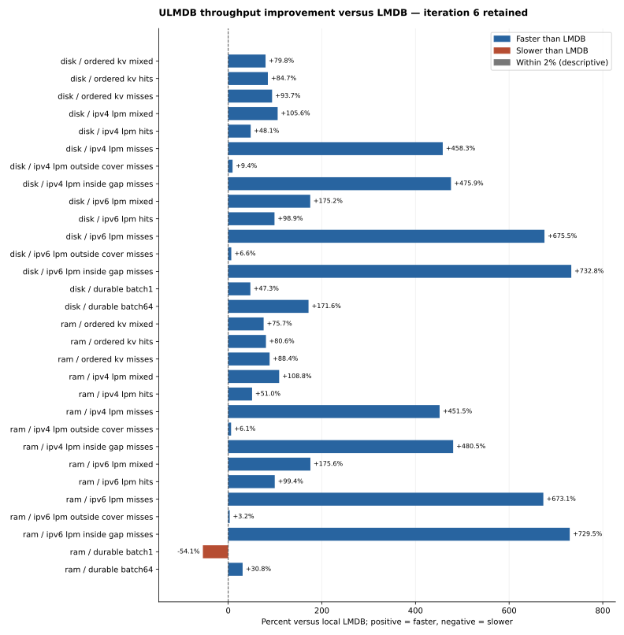

# ULMDB vs LMDB

**Measurement status: iteration 6, retained after the primary campaign and three confirmation blocks.** 807 workspace tests and all39 primary plus48 confirmation processes passed. Retained with an explicit2.2-2.5% IPv6 read tradeoff; disk sampled-tail worsening remains an open caveat. Goal active: RAM singles, loading, setup, reopening, allocation and some write latencies still trail LMDB. Published values come from the primary39-process campaign; confirmation results are separate.

Measured 2026-11-05T13:43:35.425992+00:00. Backend: **resident**. 4 fresh processes per filesystem; release build, portable CPU baseline. LMDB runs locally inside every process with normal durability flags (`0`).



## Complete read/write table

Rates are queries/s for reads and updated records/s for writes. Positive gap favors ULMDB. Values are geometric means of process rates; observed ranges are in the JSON and are not confidence intervals. Roughly on par means within 2% of the observed centre, not statistical equivalence.

The previous ULMDB column is the frozen prior executable, rerun locally in the same interleaved campaign with identical workloads; exact process order is retained in the raw evidence. Every result is retained, including lower means and slower sampled tails. Baseline rates, sampled tails and its contemporaneous LMDB measurements are in `paired_baseline` in the JSON.

|Filesystem / operation|Previous ULMDB/s|Current ULMDB/s|Change vs prior ULMDB|Fresh LMDB/s|ULMDB vs LMDB|Verdict|
|---|---:|---:|---:|---:|---:|---|
|disk / ordered_kv_mixed|6,243,148|7,330,137|+17.41%|4,076,748|+79.80%|Faster|
|disk / ordered_kv_hits|6,649,409|7,652,713|+15.09%|4,142,882|+84.72%|Faster|
|disk / ordered_kv_misses|6,479,541|7,708,110|+18.96%|3,978,780|+93.73%|Faster|
|disk / ipv4_lpm_mixed|5,469,619|5,513,008|+0.79%|2,680,988|+105.63%|Faster|
|disk / ipv4_lpm_hits|3,174,180|3,188,948|+0.47%|2,153,764|+48.06%|Faster|
|disk / ipv4_lpm_misses|21,482,051|21,655,868|+0.81%|3,879,159|+458.26%|Faster|
|disk / ipv4_lpm_outside_cover_misses|100,325,640|100,917,093|+0.59%|92,286,003|+9.35%|Faster|
|disk / ipv4_lpm_inside_gap_misses|11,466,178|11,606,005|+1.22%|2,015,409|+475.86%|Faster|
|disk / ipv6_lpm_mixed|4,392,354|4,284,398|-2.46%|1,556,785|+175.21%|Faster|
|disk / ipv6_lpm_hits|2,516,201|2,468,934|-1.88%|1,241,271|+98.90%|Faster|
|disk / ipv6_lpm_misses|17,237,117|17,149,138|-0.51%|2,211,360|+675.50%|Faster|
|disk / ipv6_lpm_outside_cover_misses|97,226,115|97,491,465|+0.27%|91,485,018|+6.57%|Faster|
|disk / ipv6_lpm_inside_gap_misses|9,220,200|9,332,632|+1.22%|1,120,666|+732.78%|Faster|
|disk / durable_batch1|14,927|15,826|+6.02%|10,741|+47.35%|Faster|
|disk / durable_batch64|493,000|484,010|-1.82%|178,232|+171.56%|Faster|
|ram / ordered_kv_mixed|6,250,079|7,120,201|+13.92%|4,052,865|+75.68%|Faster|
|ram / ordered_kv_hits|6,651,004|7,469,252|+12.30%|4,134,827|+80.64%|Faster|
|ram / ordered_kv_misses|6,497,453|7,495,281|+15.36%|3,977,680|+88.43%|Faster|
|ram / ipv4_lpm_mixed|5,462,122|5,492,890|+0.56%|2,630,134|+108.84%|Faster|
|ram / ipv4_lpm_hits|3,157,172|3,171,227|+0.45%|2,100,200|+51.00%|Faster|
|ram / ipv4_lpm_misses|21,409,697|21,543,522|+0.63%|3,906,181|+451.52%|Faster|
|ram / ipv4_lpm_outside_cover_misses|100,693,970|99,939,994|-0.75%|94,153,863|+6.15%|Faster|
|ram / ipv4_lpm_inside_gap_misses|11,579,041|11,551,516|-0.24%|1,990,091|+480.45%|Faster|
|ram / ipv6_lpm_mixed|4,378,140|4,271,910|-2.43%|1,550,202|+175.57%|Faster|
|ram / ipv6_lpm_hits|2,513,207|2,460,443|-2.10%|1,233,707|+99.43%|Faster|
|ram / ipv6_lpm_misses|17,278,087|17,141,014|-0.79%|2,217,213|+673.09%|Faster|
|ram / ipv6_lpm_outside_cover_misses|97,561,460|97,385,014|-0.18%|94,383,549|+3.18%|Faster|
|ram / ipv6_lpm_inside_gap_misses|9,339,062|9,300,426|-0.41%|1,121,264|+729.46%|Faster|
|ram / durable_batch1|58,600|62,048|+5.88%|135,053|-54.06%|Slower|
|ram / durable_batch64|957,219|967,352|+1.06%|739,504|+30.81%|Faster|

## Sampled p99

Nanoseconds; lower is better. Write p99 measures a complete transaction. It is the geometric mean of per-trial sampled p99 values, not an all-operation population percentile.

|Filesystem / operation|Previous ULMDB ns|Current ULMDB ns|Change vs prior ULMDB|Fresh LMDB ns|ULMDB excess latency vs LMDB|Verdict|
|---|---:|---:|---:|---:|---:|---|
|disk / ordered_kv_mixed|233.26|204.29|-12.42%|343.43|-40.51%|Lower cost|
|disk / ordered_kv_hits|226.46|200.48|-11.47%|341.53|-41.30%|Lower cost|
|disk / ordered_kv_misses|228.98|198.57|-13.28%|344.28|-42.32%|Lower cost|
|disk / ipv4_lpm_mixed|422.85|423.92|+0.25%|780.36|-45.68%|Lower cost|
|disk / ipv4_lpm_hits|433.91|434.07|+0.04%|791.32|-45.15%|Lower cost|
|disk / ipv4_lpm_misses|115.09|123.87|+7.63%|635.54|-80.51%|Lower cost|
|disk / ipv4_lpm_outside_cover_misses|41.26|41.65|+0.97%|45.28|-8.00%|Lower cost|
|disk / ipv4_lpm_inside_gap_misses|116.57|124.01|+6.38%|650.26|-80.93%|Lower cost|
|disk / ipv6_lpm_mixed|514.04|523.67|+1.87%|1,240.21|-57.78%|Lower cost|
|disk / ipv6_lpm_hits|540.91|543.67|+0.51%|1,258.20|-56.79%|Lower cost|
|disk / ipv6_lpm_misses|143.89|141.99|-1.32%|1,071.71|-86.75%|Lower cost|
|disk / ipv6_lpm_outside_cover_misses|41.11|41.51|+0.97%|43.35|-4.25%|Lower cost|
|disk / ipv6_lpm_inside_gap_misses|145.17|150.33|+3.55%|1,136.90|-86.78%|Lower cost|
|disk / durable_batch1|82,013.15|86,677.99|+5.69%|207,656.77|-58.26%|Lower cost|
|disk / durable_batch64|227,456.02|199,542.95|-12.27%|471,235.16|-57.66%|Lower cost|
|ram / ordered_kv_mixed|237.54|211.77|-10.85%|350.39|-39.56%|Lower cost|
|ram / ordered_kv_hits|232.06|211.43|-8.89%|353.72|-40.23%|Lower cost|
|ram / ordered_kv_misses|233.84|211.59|-9.52%|358.18|-40.93%|Lower cost|
|ram / ipv4_lpm_mixed|430.29|432.51|+0.52%|784.73|-44.88%|Lower cost|
|ram / ipv4_lpm_hits|443.06|452.48|+2.13%|797.92|-43.29%|Lower cost|
|ram / ipv4_lpm_misses|120.83|127.58|+5.59%|663.56|-80.77%|Lower cost|
|ram / ipv4_lpm_outside_cover_misses|41.65|41.52|-0.31%|47.74|-13.02%|Lower cost|
|ram / ipv4_lpm_inside_gap_misses|118.84|126.15|+6.16%|694.25|-81.83%|Lower cost|
|ram / ipv6_lpm_mixed|530.77|541.91|+2.10%|1,258.58|-56.94%|Lower cost|
|ram / ipv6_lpm_hits|556.35|560.50|+0.75%|1,285.54|-56.40%|Lower cost|
|ram / ipv6_lpm_misses|148.00|148.79|+0.53%|1,124.24|-86.77%|Lower cost|
|ram / ipv6_lpm_outside_cover_misses|41.80|41.52|-0.65%|44.73|-7.17%|Lower cost|
|ram / ipv6_lpm_inside_gap_misses|148.00|152.66|+3.15%|1,189.43|-87.17%|Lower cost|
|ram / durable_batch1|12,855.46|12,155.15|-5.45%|7,936.14|+53.16%|Higher cost|
|ram / durable_batch64|107,055.92|104,316.40|-2.56%|94,415.20|+10.49%|Higher cost|

## All measured write windows

Includes aggregate and separately sampled business commits, with timer overhead retained. Excludes validation and dispatch gaps; it is not total wall time. The original aggregate-only headlines remain above.

|Filesystem / batch|LMDB records/s|ULMDB records/s|ULMDB vs LMDB|Verdict|
|---|---:|---:|---:|---|
|disk / 1|11,179|16,294|+45.76%|Faster|
|disk / 64|182,623|502,967|+175.41%|Faster|
|ram / 1|139,288|74,780|-46.31%|Slower|
|ram / 64|746,387|978,474|+31.09%|Faster|

## Workload and reproduction

```sh
./benchmark/run.sh full --backend resident
./benchmark/run.sh full --backend resident --rounds 4 --cpu 0
```

The standard fixture has 8,192 binary KV records, 1,024 prefix insertion attempts per IP family, 4,000 queries per read case, 16 trials, and eight aggregate plus eight sampled commits per write trial. Batches contain 1 or 64 records. Trial backend order alternates. Each phase checks the complete KV state and independent IPv4/IPv6 answers outside measurement. Cold reopening and old snapshot/borrow checks remain enabled.

Reads use already bound database views in one snapshot. This measures warm embedded operations, not parsing, network service latency, concurrent writers or datasets beyond RAM. IP lookup semantics are identical; LMDB uses the benchmark prefix adapter over its generic ordered index.

SQLite is covered by the [million-operation comparison](ULMDB_VS_LMDB_VS_SQLITE.md). Production code has no LMDB or SQLite dependency. The benchmark-only pinned LMDB source and original notices live under `support/lmdb/`. Source hashes, compiler/native versions, machine, initialization, memory/file costs and exact denominators are retained in [results/full.json](results/full.json).

Bare ULMDB open, without dropping the operating-system page cache:

|Filesystem|Open ms|
|---|---:|
|disk|84.822|
|ram|44.034|

Creation, full validation and optional backend re-enable costs are separate fields in the JSON. A RAM drive has filesystem-lifetime persistence. These development measurements do not qualify crash recovery, formal correctness, Internet-scale capacity or universal LMDB parity.

Machine: `AMD EPYC 7702P 64-Core Processor`. Kernel: `6.8.0-147-generic`.
