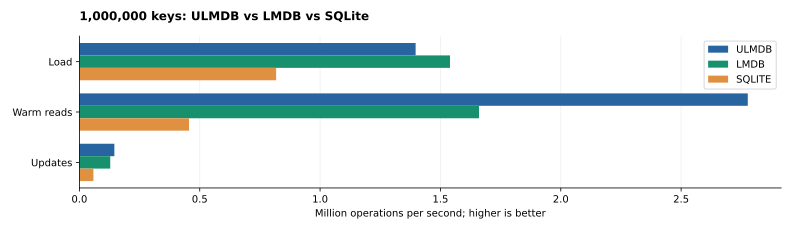
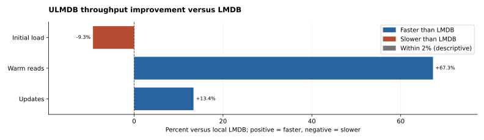
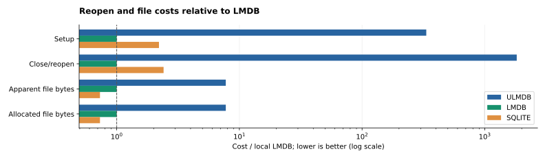

# ULMDB vs LMDB vs SQLite

**Warm reads: 1.67× LMDB and 6.10× SQLite** (2.78 million operations/s).

Recorded results use **ulmdb::resident::Environment CompactV2 Borrowed** on disk storage. This optional Resident profile differs from the default Legacy and snapshot-log backends.

1,000,000 keys, 10,000,000 reads and 1,000,000 updates per engine; 1,000 writes per durable transaction. Rates are geometric means of 3 runs, in operations per second. Higher is better.



| Operation | ULMDB/s | LMDB/s | SQLite/s | ULMDB vs LMDB |
| --- | ---: | ---: | ---: | ---: |
| Load | 1,396,940 | 1,539,753 | 817,306 | -9.28% |
| Read | 2,776,989 | 1,660,288 | 455,490 | +67.26% |
| Update | 145,257 | 128,143 | 58,247 | +13.36% |



All 9 runs passed value, miss, ordered-count and reopened-data checks.

## Startup and storage

Startup and storage costs are separate from throughput. Geometric means below; lower is better.

| Engine | Setup, ms | Close/reopen, ms | Apparent MiB | Allocated MiB |
| --- | ---: | ---: | ---: | ---: |
| ULMDB | 408.683 | 7,088.012 | 256.000 | 256.001 |
| LMDB | 1.225 | 3.892 | 33.047 | 33.043 |
| SQLite | 2.708 | 9.380 | 24.145 | 24.145 |

Close/reopen keeps OS caches. ULMDB replays and audits its WAL; SQLite includes close/checkpoint work. Allocated space includes reserved capacity.



## Method

Single process/thread, identical eight-byte keys and values. Warm reads use one bound snapshot with approximately 50% hits. Load is sorted; updates use shuffled keys. LMDB uses normal durable flags (`0`); SQLite uses prepared statements, WAL and `synchronous=FULL`.

Write rates include transaction begin, mutations and commit; read rates include loop/checksum overhead. Validation runs outside these timers. These are aggregate throughput results, not p99 latency measurements.

ULMDB automatic collection is included in writes. This profile uses 8,192 KV pages and a 2,048-page collection threshold; capacity and engine-private cache settings differ between engines.

Machine: `AMD EPYC 7702P 64-Core Processor`; `6.8.0-147-generic`.

## Reproduce

```sh
./benchmark/run.sh millions --backend resident --keys 1000000 --reads 10000000 --updates 1000000 --batch 1000
```

Requires Rust 1.94.0, a C compiler, Python 3.11+ with pip and the SQLite shared library. Use `--help` for storage, repetition and CPU-affinity options.

[Raw results and exact settings](results/millions.json) · [Read/write latency and CIDR comparison](ULMDB_VS_LMDB.md). These recorded workload results do not establish universal performance or production durability.
