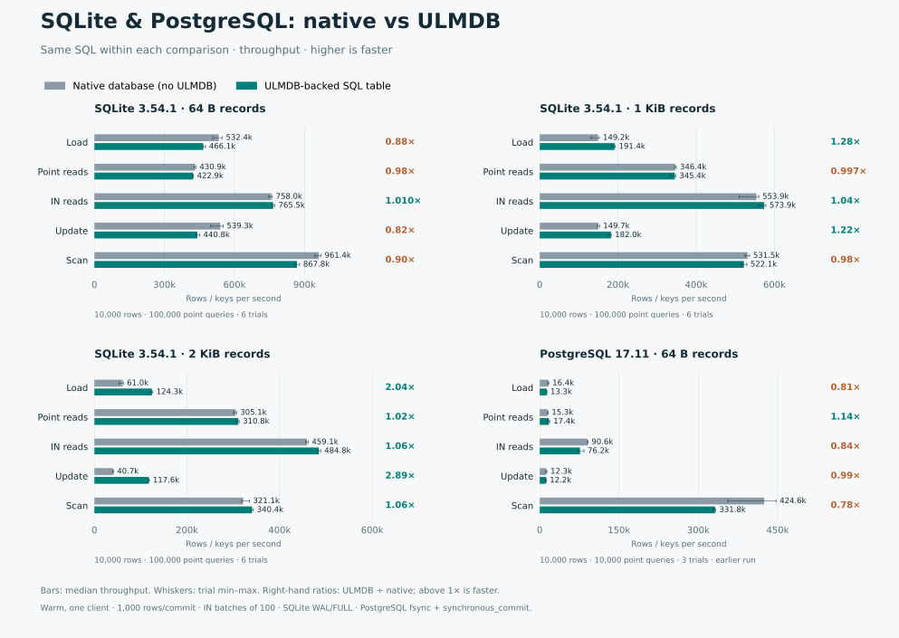

# SQL storage adapters

Optional SQL storage backed by ULMDB. Core code and default storage stay unchanged.

| Database | Interface | Build and use |
| --- | --- | --- |
| SQLite | Page VFS; virtual tables; [B-tree prototype](sqlite/btree/README.md) | [SQLite quickstart](sqlite/README.md) |
| PostgreSQL | `ulmdb_fdw` foreign tables | [PostgreSQL quickstart](postgresql/README.md) |

## Native database vs ULMDB



**Gray = native tables without ULMDB. Teal = ULMDB-backed tables.** Longer bars are
faster; right-hand ratios show ULMDB/native. Bars are medians; whiskers show trial ranges.

| Measurement | Values | Rows | Point queries | Trials |
| --- | --- | ---: | ---: | ---: |
| SQLite 3.54.1, ULMDB page VFS | 64 B, 1 KiB, 2 KiB | 10,000 | 100,000 | 6 |
| PostgreSQL 17.11, FDW with batch reads | 64 B | 10,000 | 10,000 | 6 |

- Same SQL and data per pair; warm cache, one client; 1,000 rows/commit; `IN` batches of 100.
- Values repeat a 32-byte digest; page-compression gains depend on data.
- SQLite: native WAL/FULL; ULMDB DELETE/FULL; EXCLUSIVE after schema creation, 4 KiB pages, 64 MiB cache/log budget.
- PostgreSQL: fsync, synchronous_commit and full_page_writes enabled.

## Test both adapters

```sh
storage-engines/run-docker.sh
```

Docker builds dependencies and runs SQL, ownership, commit-failure and interoperability checks.

**Experimental:** virtual/foreign tables need separate ULMDB backups and lack
atomic commits with native tables. See each quickstart's limits.
